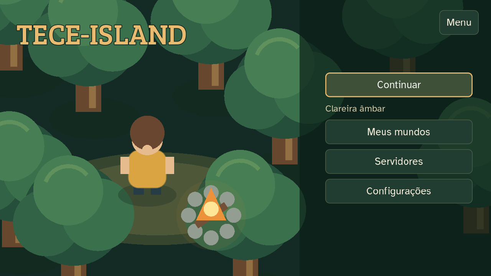
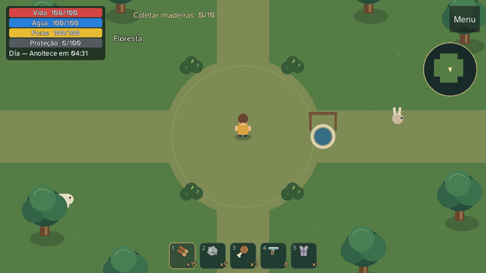
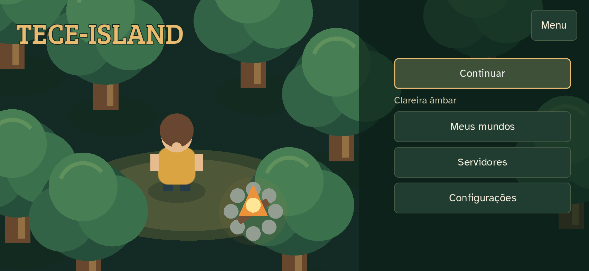
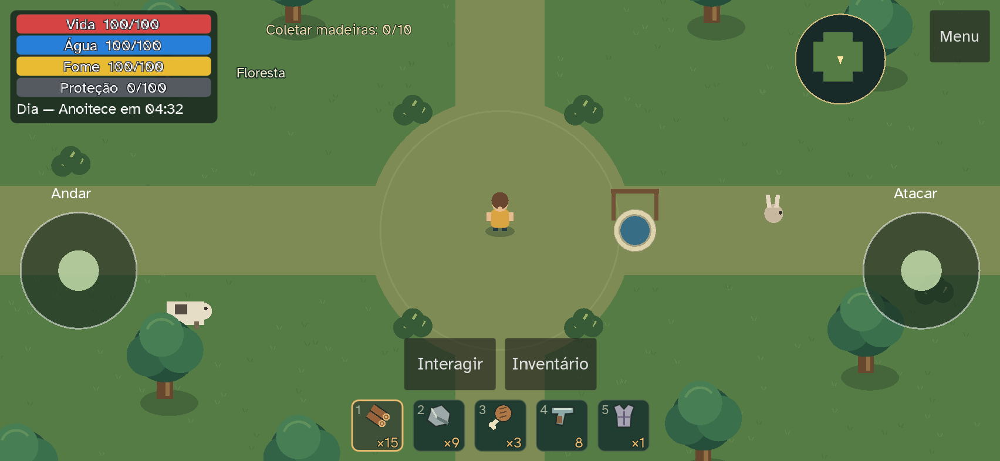
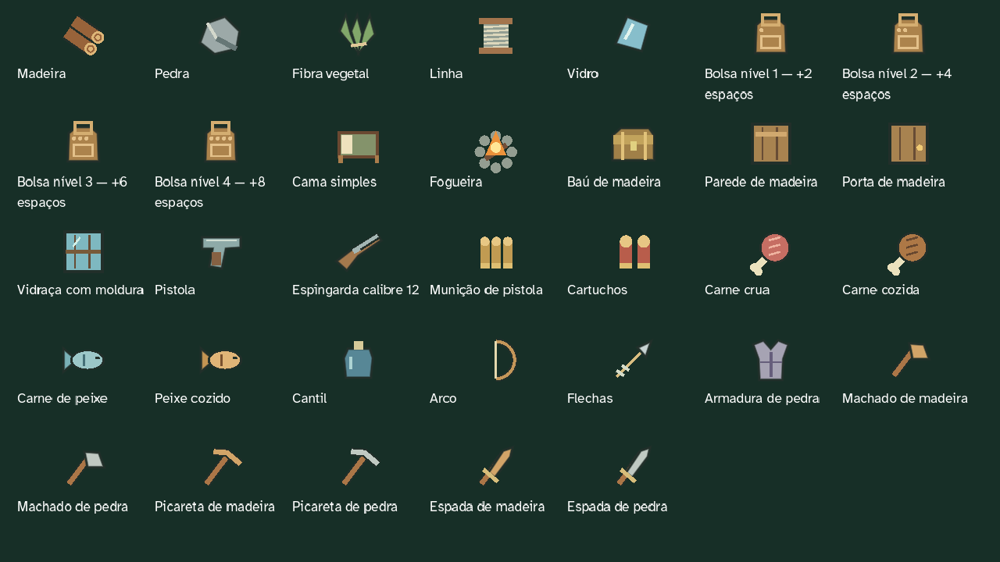

# Apresentação 0.8

Atualização de 13/10/2026 no projeto existente, R$ 0. Publicação pelo workflow
GitHub Pages existente, no [mesmo endereço](https://gustavotc-web.github.io/Tece-Island/).

## Lobby e mundos

TECE-ISLAND acompanha uma clareira com personagem, árvores e fogueira, reutilizando
os desenhos do jogo. O cenário não instancia mundo, câmera, inventário ou
necessidades; a fogueira decorativa atualiza a 8 FPS. O menu principal cabe sem
rolagem em 1280×720, 852×393 e 640×360.

Continuar identifica e abre o mundo com a última partida mais recente. Selecionar
outro mundo na lista não altera esse destino. Sem partida anterior, aparece Criar
mundo. Meus mundos tem rolagem interna, seleção clara e Jogar mundo, Criar mundo e
Renomear. Datas usam hoje/ontem ou dia/mês/ano, com horário local. A informação
“Mundos salvos neste aparelho” permanece discreta.

O campo de nome existe somente no diálogo de criação/renomeação. Na Web usa input
HTML nativo, aceita acentos, seleção e colagem e acompanha a área disponível do
teclado virtual. Cancelar mantém os mundos intactos. Renomear conserva o ID.
As regras de orientação e os campos nativos do login continuam ativos.

Servidores conserva o histórico e oferece reconexão e conexão avançada no desktop.
Na Web informa a disponibilidade no aplicativo para computador. Ajuda e saída da
conta ficam em Menu. Simulação de toque e partidas de teste ficam em Desenvolvimento,
disponível em builds de debug e oculto na publicação release.

## Fontes, itens e partida

Bree Serif no título e Atkinson Hyperlegible na interface estão incluídas com suas
licenças [SIL OFL 1.1](../assets/fonts/README.md). A exportação inclui os arquivos
locais também para os formulários HTML. Não carrega fontes externas. As duas
famílias passaram pela verificação dos acentos do português.

Os 33 itens do catálogo compartilham desenhos transparentes em barra, inventário,
equipamentos, receitas, baús, painel de base e drops. Madeira/pedra, alimentos
crus/cozidos, ferramentas por material, armas, armadura e construções têm
silhuetas próprias. Os cinco espaços rápidos mantêm teclado, scroll e toque.
Quantidade fica no canto inferior, munição usa número e cantil mostra doses/3.
A seleção tem borda âmbar e contraste.

As quatro barras conservam cores e valores; margens e espaçamentos foram reduzidos.
O relógio permanece visível. Objetivo ativo ocupa uma linha e abre a lista completa,
com os efeitos de conclusão preservados. Nomes dos prédios aparecem por proximidade.
O minimapa dispensa a legenda redundante. O aviso de save mantém sucesso temporário,
erro e nova tentativa. Os alvos de toque principais têm pelo menos aproximadamente
44 pixels CSS após a escala.

Save v5, UID, IDs, migração, backups e mecânicas permanecem. Conta vazia já não
fabrica automaticamente um mundo; o usuário confirma o primeiro nome no diálogo.

## Verificações executadas

Godot 4.7.2 no Windows e Edge/Playwright:

| Ambiente | Resultado |
| --- | --- |
| 28 scripts nativos de regressão | 591 verificações, zero falhas |
| Apresentação nativa | 51 verificações, zero falhas: catálogo, fontes, cenário, Continuar, datas e IDs |
| ENet em dois processos locais, limitados a 60 FPS | 72 verificações, zero falhas |
| Apresentação no navegador | 90 verificações, zero falhas: PC 1280×720, toque emulado 852×393 e 640×360 |
| Regressão de mundos/mecânicas no navegador | 41 verificações, zero falhas: migração, isolamento, multitoque, objetivos e retry de save |
| Login principal, Firebase real | 28 verificações, zero falhas: edição, seleção, colagem, rotação, cadastro/recuperação e rejeição de credenciais inválidas |
| Exportação release local | 4 verificações, zero falhas; fontes, ausência de fixture, criação e início de partida; menu revisado por captura |
| Celular físico | Pendente; roteiro abaixo |

Autenticação positiva foi interceptada apenas em navegadores de teste isolados;
as fixtures nativas usam cenas e caminhos próprios. Nenhum teste acessa saves
pessoais. A exportação pública mantém login obrigatório e exclui as fixtures.
Capturas release adicionais confirmam o menu sem Desenvolvimento e as fontes
locais. Emulação de toque e redução do viewport não substituem teclado virtual
ou desempenho de aparelho físico. O probe ENet de movimento falhou sem limite de
FPS no headless; passou com ambos os processos a 60 FPS, sem alterar mecânicas
ou tolerâncias do teste.

Reprodução: `tools/validate-next-update.ps1`, `tests/validate_presentation.gd`,
`tools/presentation-validation.mjs`, `tools/next-update-validation.mjs`,
`tools/mobile-login-validation.mjs` e `tools/presentation-release-check.mjs`.
Resultados JSON/logs ficam em `.tools/`, fora do Git. A exportação principal
foi importada e exportada em release sem erros de script.

## Capturas revisadas

PC, 1280×720:

Mobile **emulado**, 852×393 CSS, densidade 2:

Catálogo compartilhado, ampliado para conferência:

## Roteiro curto em celular físico

1. Digite/cole e-mail e senha no teclado virtual, entre e gire para horizontal.
   Confira acentos, bordas seguras e menu principal sem rolagem.
2. Crie/renomeie um mundo com acentos; confirme e cancele com teclado aberto.
   Selecione outro mundo e confira o destino de Continuar.
3. Leia barras, relógio, objetivo e quantidades. Selecione os cinco espaços por
   toque; ande e ataque com dois dedos sem sobrepor os controles.
4. Abra/feche inventário, objetivos, configurações e ajuda. Toques nos painéis
   devem pausar o solo e não atacar, mover ou coletar por baixo.
5. Aguarde Salvo, volte ao lobby e recarregue. Entre e confira cada mundo.
   Suspenda/gire o aparelho para verificar liberação dos comandos e FPS.
