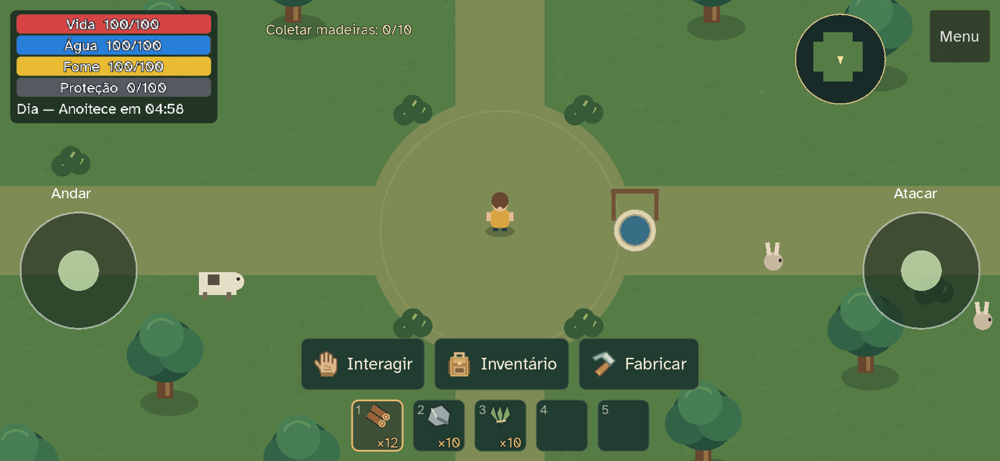

# Atalhos mobile · 0.8.1

Três acessos ficam juntos acima dos cinco espaços rápidos: mão **Coletar/Interagir**,
mochila **Inventário** e martelo **Fabricar**. Ícones SVG transparentes acompanham
legendas visíveis, com o verde, madeira e âmbar da interface. Comer/Beber e Recarregar
ocupam uma linha separada, conservando a área dos joysticks.

Fabricar chama `HUD.set_panel("crafting")` e reutiliza `CraftingView`, suas categorias,
receitas, ingredientes e fabricação. O inventário mantém seu acesso anterior.
Cada painel tem Fechar. Alternar oculta o painel anterior; pausa solo, bloqueio de
comandos e liberação dos dedos são os mesmos do sistema existente. O atalho C,
inventário por I e os controles do computador permanecem.

A mão mostra Coletar quando o alvo próximo é um drop e Interagir nos demais casos.
O comando contextual conserva coleta, baús, poços, camas, fogueiras, portas e registros.
Os alvos principais têm ao menos aproximadamente 44px CSS. O layout usa o canvas
dentro das áreas seguras já tratadas pela página.

## Verificação

Godot 4.7.2 e Edge/Playwright no Windows. Testes nativos: 30 verificações mobile,
12 de fabricação e 7 de controles, zero falhas. O teste mobile inclui toque no
atalho direto, categoria/receita, consumo dos ingredientes, fechar, alternar
inventário/fabricação e liberação de movimento/ataque mantidos.

58 verificações de navegador passaram, sem erros. `tools/mobile-shortcuts-validation.mjs`
verifica os layouts 852×393
e 640×360 com **toque emulado**, e o atalho C/I no PC 1280×720. Inclui fabricação
com rolagem por gesto, fechar/alternar painéis, ausência de ações por baixo, coleta,
baú contextual, movimento e ataque simultâneos, disparos interrompidos ao soltar,
seleção rápida e disposição de Comer/Recarregar. Usa uma fixture offline isolada,
excluída da publicação. Login obrigatório e saves pessoais ficam preservados.
Resultados e logs estão em `.tools/mobile-shortcuts-*`, fora do Git.

## Captura

Mobile **emulado**, 852×393 CSS, densidade 2:

## Conferência em aparelho físico — pendente

1. Entre no mesmo [jogo](https://gustavotc-web.github.io/Tece-Island/) em paisagem.
   Confira os três ícones, legendas, bordas seguras e espaço entre os comandos.
2. Toque em Fabricar, escolha categoria/receita, fabrique e feche. Abra Inventário,
   use seu acesso à fabricação e confira que aparece somente um painel.
3. Colete um drop e abra um baú pela mão. Selecione os cinco espaços, coma/beba
   ou recarregue e confirme que os botões não se sobrepõem aos joysticks.
4. Ande e ataque com dois dedos; abra um painel mantendo ambos. Ao fechar,
   não deve haver movimento ou ataque preso. Suspenda e retome o aparelho.
