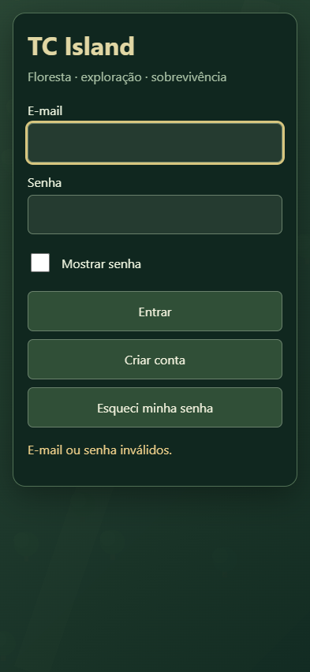
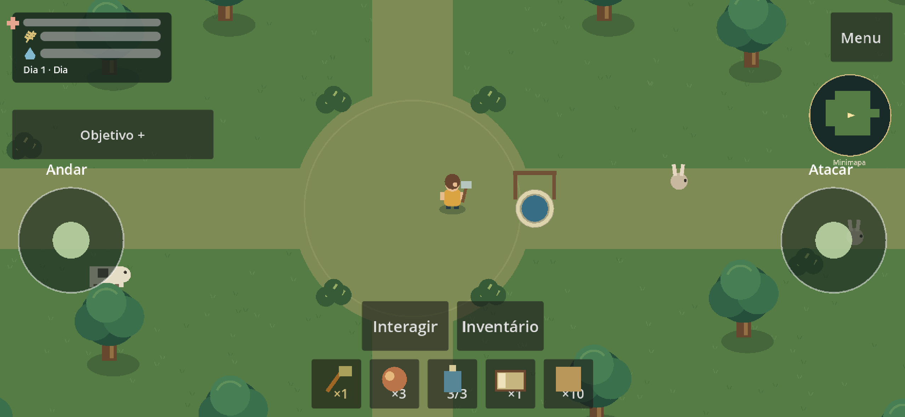
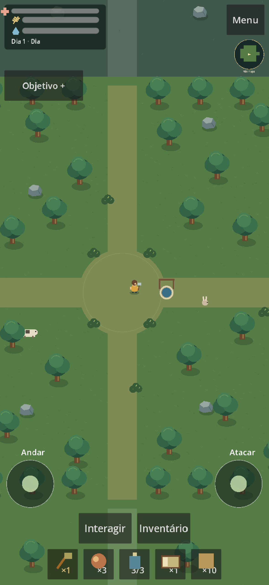

# Usabilidade mobile

## Login — causa e correção

Reprodução na exportação anterior, Godot 4.7.2, Edge/Windows com toque
emulado: o primeiro toque no e-mail previamente focado deixava o canvas ativo;
trocar para senha ativava o input oculto do teclado virtual; tocar novamente
desativava esse input e devolvia o foco ao canvas. O `MobileInput` consumia o
toque e chamava `LineEdit.edit()`, enquanto o adaptador Web usava um input
oculto, desativado no blur. Não houve evidência de falha no Firebase.

A autenticação Web usa agora inputs HTML visíveis, com teclado de e-mail,
edição nativa, seleção/colagem, senha sem capitalização ou correção e rolagem
com `visualViewport`. O formulário envia operações ao `FirebaseAuth` existente
via `JavaScriptBridge`; não há outro serviço, SDK ou armazenamento de sessão.
O formulário nativo do Godot permanece. Tokens continuam apenas em memória.

Referências oficiais: [teclado virtual Web](https://docs.godotengine.org/en/stable/classes/class_editorexportplatformweb.html)
e [integração JavaScript](https://docs.godotengine.org/en/stable/tutorials/web/javascript_bridge.html).
O template instalado contém `GodotDisplayVK`: input oculto, focus no show e
desativação no blur. Essa investigação inspecionou o template realmente exportado.

### Testes da etapa de login

- `node tools/login-focus-reproduction.mjs`: reproduziu o problema anterior;
  executar contra a versão anterior (teste histórico).
- `node tools/mobile-login-validation.mjs`: 28 verificações no Edge Chromium
  instalado no Windows, desktop 960×540 e toque emulado 393×852/852×393,
  viewport reduzido a 393×300. Foco, edição, colagem real do clipboard, exclusão,
  cursor, mostrar/ocultar, modos cadastro/recuperação e rotação.
- Duas solicitações reais de login com credenciais de teste inválidas:
  rejeitadas pelo Firebase; mensagem e nova tentativa disponíveis.
- `tests/native_auth_ui_probe.gd`: 5 verificações com renderização nativa
  Compatibility/Intel Iris Xe; `tests/validate_auth_release.gd`: 10 verificações
  de configuração, bloqueio de entrada, expiração e logout sem sessão positiva.

Nenhum celular físico, Safari ou teclado virtual real foi testado nesta etapa.
A redução do viewport simula espaço disponível; não prova funcionamento de IME.
Cadastro/confirmar/recuperar com conta real foram validados pelo proprietário
na versão anterior, e precisam de nova conferência da apresentação no aparelho.

### Conferência no celular físico

1. Abra https://gustavotc-web.github.io/Tece-Island/ no aparelho e informe
   aparelho, navegador e versão caso encontre uma falha.
2. Toque uma vez no e-mail; digite, selecione, cole e apague. Troque para senha,
   incluindo maiúsculas e símbolos. Confira mostrar/ocultar e a posição do cursor.
3. Com o teclado aberto, role até Entrar; gire o aparelho nas duas orientações,
   feche/reabra o teclado e confirme que o texto continua intacto.
4. Confira cadastro, confirmação e recuperação com sua própria conta;
   nunca envie senha ou tokens pelo chat.

## HUD e controles

Vida/fome/sede usam símbolos desenhados e barras compactas, dia/noite discreto,
minimapa no canto e cinco slots com as imagens procedurais existentes, quantidade
e seleção destacada. Munição e veneno são contextuais. Objetivo mobile começa
recolhido; os indicadores `+`/`-` substituem os glifos triangulares indisponíveis.
Atalhos e totais de recursos saíram da HUD permanente.

Menu reúne continuar, diário/objetivos, configurações, ajuda, dados/save, voltar
e logout. Fabricação e Base ficam no inventário. Comer/beber e recarregar são
contextuais, usando as mesmas funções anteriores. Retrato permite jogar;
joysticks, ações e slots ocupam faixas separadas. Os botões de toque consideram
a proporção entre viewport lógico e tamanho CSS do canvas, com mínimo de 44px.
As bordas seguras continuam no shell Web. Formulários longos têm rolagem.

Sucesso de save desaparece após 2,5s; falha permanece com nova tentativa e
também pode ser tratada em Dados e salvamento. Avisos desabilitados/Ignore
não interceptam o toque em outros botões. A pausa do solo permanece; a arena
continua enviando bloqueio local sem pausar a simulação compartilhada.

“Copiar informações” inclui apenas versão, commit, plataforma, resolução e
orientação. `node tools/stamp-build.mjs` prepara o identificador para F5/exportação
local; o Actions usa seu próprio `GITHUB_SHA`. Não depende de configuração do
notebook. Sem arquivo de versão, o diagnóstico informa “desenvolvimento”.

### Validação da interface e regressão

- `tools/validate-signal.ps1`: 496 verificações em 23 scripts, nenhuma falha.
  Abrange mecânicas, inventário, fabricação, alcance, construção, saves por UID,
  auth, objetivos e mundo. Inclui a regressão do aviso Ignore sobre outro botão.
- Godot nativo Compatibility/Windows/Intel Iris Xe: `validate_menu.gd`
  (14 verificações de mouse/teclado, reentrada e anfitrião) e `validate_mobile.gd`
  (24 verificações de eventos injetados, não um aparelho físico).
- Edge/Windows: `mobile-hud-validation.mjs`, 60 verificações, desktop 960×540,
  toque emulado 852×393 e 393×852 com DPR 3. Multitouch, foco, slots ≥44px CSS,
  consumo unitário, coleta parcial/cheia, fabricação com rolagem, prévia/confirmar,
  menu, reentrada e ausência de erros. Os dois estados visuais de save foram
  injetados exclusivamente na fixture; não representam falhas reais de disco.
- `signal-validation.mjs`: 50 verificações em desktop/toque. Áudio, diário,
  objetivos, nome e transferências do baú, desmontagem, dano/veneno e saves
  gravados/lidos via serviço GDScript e IndexedDB real com UIDs de fixture.
  A exportação de gameplay é offline e separada, excluída da versão publicada.
  Nenhuma sessão Firebase positiva foi simulada.
- `diagnostic-validation.mjs`: botão de suporte copiou os cinco campos públicos
  esperados para o clipboard real, sem informações da conta ou do save.

No celular físico, além do login, confira andar/atacar com dois dedos, coletar,
comer/beber uma vez, reorganizar itens, fabricar, construir/confirmar/cancelar e
voltar após bloquear a tela. Confira também a rotação com um painel aberto.
Safari/iOS, teclado virtual em celular físico, recortes reais e desempenho do aparelho
permanecem pendentes. O proprietário precisa repetir o fluxo positivo no aparelho;
as credenciais não são solicitadas nem registradas pelo agente.

### Capturas da exportação Web

