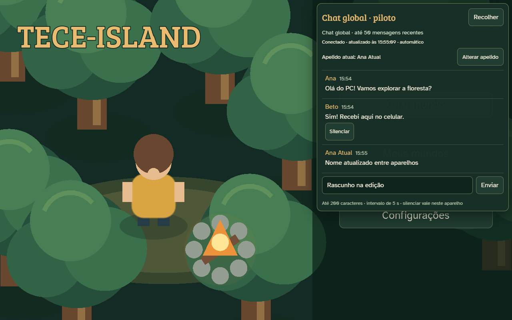
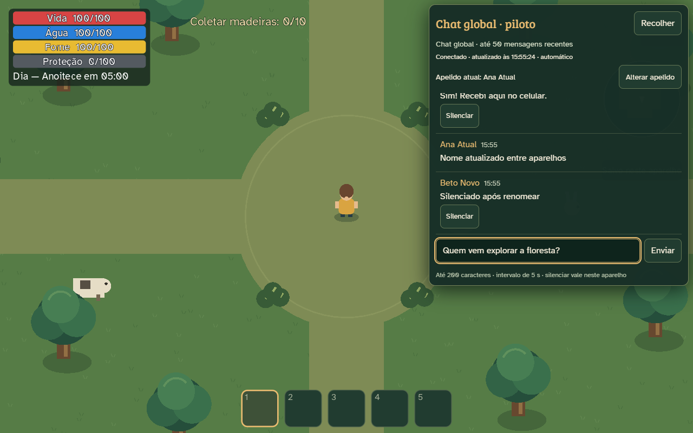
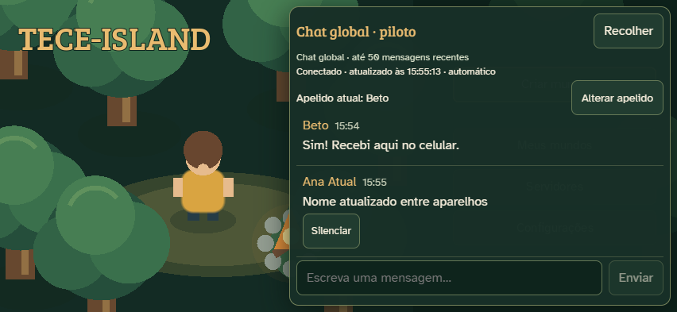
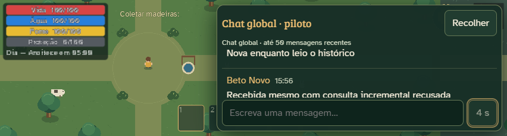
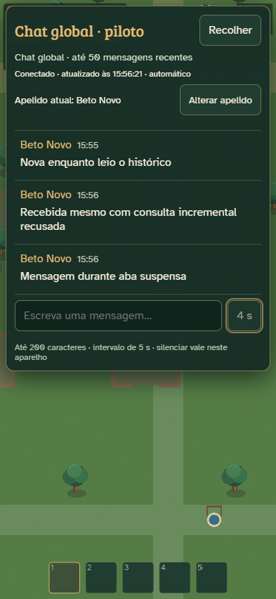

# Validação do chat

## Revisão 0.8.2-chat-pilot.3 — 16/10/2026

Regras locais: **21 subtestes aprovados**, incluindo update do próprio perfil,
recusa de alteração alheia (inclusive por admin), limites/caracteres/campos,
nome antigo preservado nas mensagens, rejeição do apelido desatualizado no envio
e ausência de promoção por usar um nome administrativo. Incluem os 12 checks
REST nativos dos saves. **155 verificações de saves aprovadas** novamente.
O diff de regras só altera duas linhas de `chatProfiles`; todo o restante é
idêntico ao .2, e o bloco de mundos continua idêntico à base `f2dd666`.

**44 verificações Web aprovadas**, zero erros GDScript/JavaScript, máximo de
**1 pedido de chat simultâneo por sessão**. Duas sessões Edge/Playwright usam
transporte REST Godot contra o emulador, com painéis continuamente abertos por
mais de 15 s no lobby e na partida pausada. Incluem salvar/cancelar/validar
apelido, persistência em outra sessão e reload, envio com nome atualizado em
outro aparelho, histórico antigo, silêncio após renomear, rolagem/aviso/rascunho,
erro de consulta injetado e fallback, perda de rede, despertar por eventos,
logout com pedido pendente, troca de conta e remoção por reconciliação natural.
**9 checks nativos** de transporte/perfil e **7 de controles** também aprovados.

Latências medidas do acionamento de Enviar à exibição no destinatário:

| Situação | Tempo |
| --- | ---: |
| Lobby, PC → mobile emulado | 5,171 s |
| Lobby, mobile emulado → PC | 1,416 s |
| Partida pausada, PC → mobile emulado | 5,214 s |
| Partida pausada, mobile emulado → PC | 1,000 s |
| Retorno de aba oculta simulada | 0,422 s |
| Remoção administrativa no outro painel | 118,986 s |

[Resultado bruto sanitizado](chat-pilot3-results.json). Essas medidas incluem
envio, rede local, renderização e polling; não caracterizam uma distribuição
estatística nem a latência do Firebase real. Não houve login positivo no
Firebase de produção. Teclado/visibilidade de aba são simulados. Testes físicos
permanecem pendentes. [Diagnóstico e reteste](RETESTE_CHAT_PILOT3.md).

O responsável já confirmou envio/visualização entre PC e celular no .2,
com falhas de apelido e atualização automática. A tentativa automatizada de
reproduzir no .2 com 18 s abertos no lobby e 18 s pausado recebeu as mensagens;
a causa em produção não foi confirmada. A nova suíte mede recebimento natural,
sem comandos de polling, e testa recuperação de uma falha de consulta injetada.

## Histórico — 15/10/2026

Versão: `0.8.2-chat-pilot.1`, branch `feat/global-chat-pilot`.
Estado da configuração remota: não alterada/não validada nesta entrega.
Plano de teste em Firebase real: [Chat global](CHAT_GLOBAL.md).
Continuação publicada como `0.8.2-chat-pilot.2`: [registro da publicação privada](PUBLICACAO_CHAT.md).
Os resultados da interface abaixo pertencem à implementação inicial; a continuação
reexecutou as regras e os saves e conferiu o pacote combinado, conforme o registro.

## Automatizados: regras locais

20 subtestes aprovados, zero falhas, executando as regras de mundos e chat no
Firestore Emulator `demo-tece-island`. Incluem 10 subtestes novos do chat:
duas contas, e-mail verificado, bloqueio anônimo/fora da lista, UID e apelido
falsificados, campos privados extras, intervalo no backend, batch incompleto,
sequência/slot inválidos, texto vazio/201 caracteres, consulta sem limite/51,
perfil imutável, privilégios administrativos, exclusão e concorrência.
105 envios de fixture confirmaram no máximo 100 documentos e a janela final 56–105.
O relógio de rate é envelhecido administrativamente em alguns casos de teste;
nenhuma funcionalidade do jogo permite isso. O teste do excesso ignora o timer
cliente para comprovar a recusa nas regras.

A suíte existente dos mundos passou, incluindo 12 verificações do transporte
REST no Godot nativo. Regras antigas dos mundos foram preservadas no arquivo.

```powershell
npm run test:chat
```

Quando os executáveis estão nas pastas locais deste ambiente, definir `JAVA_HOME`
para `.tools/java/jdk-21.0.12.1+1-jre`, acrescentar seu `bin` ao PATH,
`XDG_CONFIG_HOME` para `.tools/firebase-test-config`, `FIREBASE_EMULATORS_PATH`
para `.tools/firebase-emulators` e `GODOT_EXE` para o Godot console. Todas as
variáveis devem usar caminhos absolutos. O emulador não usa credenciais de produção.

## Automatizados: regressão de saves

155 verificações aprovadas, zero falhas, em nove suítes:
World Library 19; Account Progress 21; Session Progress 10; Save Reliability 20;
World Sync 22; Chest/Bow Save 26; Auth Release 10; Sync Pilot 13; Sync Handoff 14.

```powershell
powershell -NoProfile -ExecutionPolicy Bypass -File tools/validate-saves.ps1 -Godot "CAMINHO/Godot_console.exe"
```

Esses resultados são automatizados, com dados e transportes de teste conforme
cada suíte. Não confirmam o reteste físico do piloto de sincronização.
Outras sete verificações existentes de controles/coleta/toque passaram em
`tests/validate_controls.gd`, após integrar o bloqueio de entradas do chat.

## Capturas da exportação Godot Web

23 verificações aprovadas, zero falhas e nenhum erro GDScript/JavaScript. Duas
sessões Edge independentes usaram o transporte REST real do jogo contra o emulador:
apelido, envio/resposta, excesso ignorando o timer cliente, silenciar/reativar,
ausência de consultas com painel fechado, abrir/recolher repetidamente,
digitação sem movimento/ataque/atalhos, envio com Enter, viewport de teclado
reduzido, retrato, perda de rede, rascunho preservado, reconexão, limite de 200,
HTML literal, remoção administrativa, logout com pedido pendente e troca de conta.
Não houve tráfego para serviços HTTPS externos no teste de interface.

Seis verificações adicionais do transporte **Godot nativo headless** passaram no
mesmo emulador: leitura de perfil, commit com timestamp do servidor, recebimento,
recusa de excesso pelo backend, encerramento de pedidos e formato do apelido.
São execução nativa automatizada, sem inspeção visual física do aplicativo.

Para repetir a interface, exportar `-Emulated -AllowedUid 'chat-a,chat-b,chat-admin'`,
iniciar o Firestore Emulator local com as regras do projeto e executar
`node tools/chat-browser-validation.mjs` com `FIRESTORE_EMULATOR_HOST=127.0.0.1:8085`.
O teste usa Playwright instalado em `.tools/browser-test/`. O relatório fica em
`.tools/chat-browser-results.json`. O teste nativo é
`--headless --path . --script tests/validate_chat_transport.gd`; executar depois
do teste Web, que prepara o perfil e o acesso dessas contas fictícias no emulador.

Capturas reais do jogo exportado no Edge headless, com backend Firestore local
e identidades explícitas de fixture. O celular é emulado; o teclado não é físico.











## Teste físico e real pendente

- Aplicar regras revisadas e configurar `chatSettings/global`, sem alterar o acesso
  aos mundos e sem faturamento. Conferir administrador por UID no backend.
- Duas contas reais verificadas: enviar PC → celular → PC, conferir autores e hora
  local; tentar envio rápido nas duas abas da mesma conta.
- PC nativo: abrir o piloto separado, confirmar o painel e entrada/saída na partida.
- Android/iOS físico: tocar, colar, editar, abrir teclado, enviar pelo botão e pela
  tecla de envio, recolher e retomar movimentos sem tecla/ataque mantido.
- Sem rede: manter rascunho, fechar painel, continuar e salvar; reconectar e conferir
  o histórico antes de repetir um envio de confirmação incerta.
- Logout/troca de conta/reabrir navegador: não carregar apelido, silenciamentos ou
  rascunho da outra conta; a conversa global é intencionalmente compartilhada.
- Administrador: remover; outra sessão deve reconciliar em até 120 s, ou reabrir
  depois do intervalo. Usuário comum não pode remover nem conceder privilégios.
- Registrar separadamente os testes pendentes do `0.8.1-sync-pilot.2`: falso conflito,
  reabertura do navegador e isolamento entre contas. Permanecem sem aprovação física.

As exportações locais emitem avisos do sandbox sobre acesso às preferências do
editor Godot e à loja de certificados do Windows. A compilação/exportação foi
verificada separadamente de conectividade TLS real; o piloto local não prova
acesso ao Firebase real deste ambiente.
